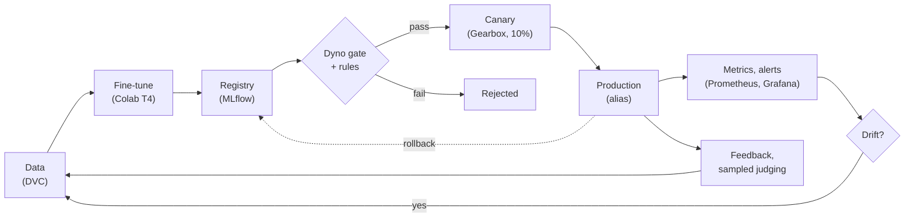
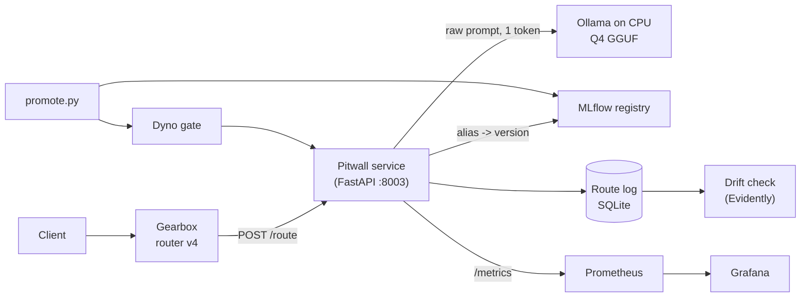
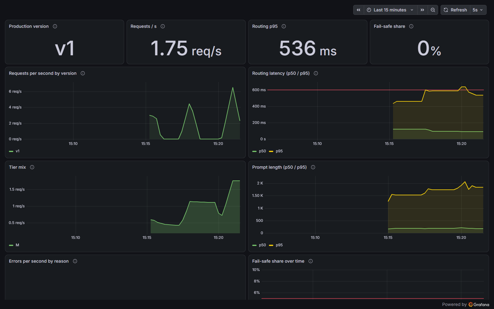

# Pitwall

[](https://github.com/Utsav0706/pitwall/actions/workflows/ci.yml)

LLMOps for one real model: a 0.6B open LLM fine-tuned to pick
[Gearbox](https://github.com/Utsav0706/gearbox)'s tier (S, M or L) for a prompt. Pitwall
versions its data, trains it, tracks every run, gates it with
[Dyno](https://github.com/Utsav0706/dyno), serves it, sends it live through a canary,
monitors it, detects drift, and retrains it.

One of four connected projects: [Scout](https://github.com/Utsav0706/scout) (research
agent), Gearbox (LLM router), Dyno (agent evals) and Pitwall.

> **A fine-tuned Qwen3-0.6B router runs the whole loop (versioned data, Colab training,
> MLflow registry, Dyno gate, canary through Gearbox, monitoring, drift, retraining,
> rollback) and replaces Gearbox's paid LLM classifier at higher quality (94.7% vs 90.6%
> of always-L) for about £0 per decision. It does not beat the free rule "always use
> M": it learned to route everything to M.**

## Results

All on the same 119 held-out prompts (Gearbox's test split). Quality and cost come from
Gearbox's own offline replay of the answers each router's picks would have bought
([`reports/compare.md`](reports/compare.md)); nothing here re-ran a paid model.

| Router | Accuracy | Under-routed | Pass | Quality vs always-L | Cost vs always-L | Routing p50 / p95 |
|---|---|---|---|---|---|---|
| always-M (Haiku) | 47.9% | 8.4% | 78.2% | 94.7% | 6.0% | – |
| always-L (Sonnet) | 8.4% | 0.0% | 84.0% | 100% | 100% | – |
| Gearbox v2: Haiku classifies the prompt (paid) | 60.5% | 12.6% | 73.9% | 90.6% | 19.5% | 1,952 / 4,712 ms |
| Gearbox v3: embeddings + logistic regression | 46.2% | 8.4% | 78.2% | 94.7% | 7.1% | 36 / 125 ms |
| Logistic regression on Pitwall's first training set | 51.3% | 8.4% | 78.2% | 94.7% | 5.9% | – |
| **Fine-tuned Qwen3-0.6B, v1** (first training set) | 47.9% | 8.4% | 78.2% | 94.7% | 6.0% | 108 / 488 ms |
| **Fine-tuned Qwen3-0.6B, v2** (retrained after drift) | 47.9% | 8.4% | 78.2% | 94.7% | 6.0% | 76 / 259 ms |

*Under-routed*: a smaller tier than needed (a worse answer). *Pass*: the picked tier's
stored answer scored at least 4/5 with Gearbox's judge.

**Reading it.** Both fine-tunes put a probability of 0.23-0.33 on S for every prompt,
with the same average whatever the right tier is: they learned the label mix, not the
prompts, so the threshold sends everything to M. The logistic regression and Gearbox's
own routers found the same thing: which tier a prompt needs is barely predictable from
its text. Against the paid classifier the fine-tune wins (better quality, a third of the
cost, no API call); against "always M" it ties. The quantised model reproduces the
validation numbers recorded during training, so this is the model, not the Q4 export.
v2's lower p95 is the same model size measured on a less busy machine.

## The loop, run end to end



Production v1 (trained on general prompts) started seeing SimpleQA, AIME and MMLU-Pro
prompts. What happened next, live:

| Step | Result |
|---|---|
| Drift check | **drift** on all 3 features: prompt length (p = 0.005), task mix (research 26% -> 51%, coding -> 0%), meaning (embedding classifier ROC AUC 0.90); alert `PitwallDrift` fired |
| Failures | 2 thumbs-downs + a 10-prompt sample judged by Dyno (8/10 passed, GBP 0.0058) -> 4 new Dyno cases and queued training prompts |
| Retrain | v2 on old + new prompts (481), Colab T4, 256 s |
| Gate (dry run) | Dyno accuracy 48% -> 48%, under-routing 8.4% vs 8.4%, p95 within 600 ms: would promote |
| Canary through Gearbox | 40 real requests, GBP 0.0078, 5 (12%) to v2 |
| Promote | v2 is production; the service picked it up within 30 s, no restart |
| Same traffic again | **no drift** against v2's training data (1 of 3 features; AUC 0.66); alert cleared |
| Rollback | production v2 -> v1, then promoted again through the gate |

Every decision is an MLflow run, written before the alias moves:
`always-M -> v1` promoted, `v1 -> v2` would promote then promoted, `v2 -> v1` rolled
back, `v1 -> v2` promoted. v2 routes like v1, so it was promoted for **tying** on every
rule, not for routing better; what changed is that production now knows the new kind
of prompt.

## How it works



1. **Data** is Gearbox's labelled prompts, imported with DVC from a pinned commit and
   rebuilt byte for byte in CI.
2. **Training** is LoRA on Qwen3-0.6B-Base on a free Colab GPU; it produces a bundle
   (GGUF Q4, adapter, a manifest that records the data, prompt and code versions).
3. **Promotion** is code: Dyno's gate on 119 cases through the running service, no more
   under-routing, p95 within 600 ms. Moving the MLflow alias promotes or rolls back.
4. **Serving** answers `POST /route` from Ollama on CPU; Gearbox calls it as router v4
   and falls back to M if Pitwall is down.
5. **Monitoring** watches latency, tiers, fail-safes and drift; failures (thumbs-down,
   judged answers) become Dyno cases and training data for the next round.

The details, with more diagrams: [docs/design.md](docs/design.md). Questions:
[docs/faq.md](docs/faq.md).



## Why X over Y

| Choice | Over | Why |
|---|---|---|
| LoRA in fp32 + fp16 autocast | QLoRA | A 0.6B model fits a free T4 at full precision; 4 bits would only add a dependency, slower steps and some accuracy loss |
| One fixed text, Ollama raw mode | Chat templates | Training and serving read exactly the same tokens (checked: same token count); templates differ between Hugging Face and Ollama |
| Probabilities of S/M/L + a threshold | Taking the generated letter | Under-routing can be traded against cost, with the same rule as the logistic regression baseline |
| MLflow aliases (`production`, `candidate`) | Model stages | Stages are deprecated; an alias move is the whole promotion or rollback |
| Dyno's gate, same day, same cases | A custom accuracy check | One gate for agents and routers; runs both versions through the live service, so it tests what users get |
| Test evaluated once, on the Q4 model on CPU | Scoring the fp16 model on Colab | The number that counts is the one from the model that serves |
| Evidently with pinned tests | Its automatic choice | It switches to distance scores on larger samples, which would flip "low = drift" to "high = drift" |
| Distinct prompts in a drift window | Every request | Repeats leak across the embedding classifier's own split and fake drift (AUC 0.81 on normal traffic before the fix) |
| Production prompts in DVC | Git | Versioned like data, kept out of a public repository |
| Logistic regression baseline, rebuilt here | Gearbox's numbers | Same split, same features: it reproduces Gearbox v3's picks on all 119 prompts, so the comparison is fair |

## Constraints and trade-offs

- **Cost.** Training on free Colab, serving on CPU, no GPU instances. Total paid spend
  for the whole project: about **GBP 0.022** (two canaries through Gearbox, one sampled
  judging run). Every paid command shows an estimate first and has a cap.
- **The model doesn't route better than "always M".** That is the finding, not a bug:
  the labels (cheapest tier that answered well) are barely predictable from the prompt.
  The operations loop around the model works regardless, and is what Pitwall is for.
- **Small test set.** 119 prompts; one prompt is 0.8 points of accuracy. The gate
  allows no drop, and the router is deterministic (two Dyno runs of v1 agreed on all
  119), so noise is not the risk; sample size is.
- **CPU latency grows with prompt length.** ~60 ms for short prompts, ~300 ms and more
  for long ones. The promotion limit (600 ms p95) was set from that measurement.
- **Not deployed to the cloud yet.** Everything runs locally and in CI (the service
  image, and Prometheus + Grafana with Docker Compose). The cloud deployment, with one
  command to create and one to tear down, is planned together with the other three
  projects.
- **Out of scope:** Kubernetes (one small service doesn't need an orchestrator),
  multi-model serving and autoscaling (one model, one machine), vLLM on GPU (the model
  is 0.6B and runs on CPU). Labelling queued production prompts (Gearbox's answer +
  judge pipeline, ~GBP 0.0075 each) is ready to add, not added.

## Run it

Windows PowerShell; Python 3.12+; Ollama installed.

```bash
py -m venv .venv
.venv\Scripts\activate
pip install -e ".[dev,ops,baseline,serve,gate]"
pitwall doctor                                # tools and local servers
dvc update -R data/gearbox                    # Gearbox's labelled prompts (pinned)
dvc repro                                     # instruction pairs, splits, gate cases
python scripts/mlflow_server.py               # MLflow, http://127.0.0.1:5000
python scripts/dev_api.py                     # the service, http://127.0.0.1:8003
```

| Command | What it does |
|---|---|
| `pitwall baseline` / `reference` / `compare` | Logistic regression baseline, reference rows, `reports/compare.md` |
| `pitwall evaluate BUNDLE` / `register BUNDLE` | Score a trained bundle on CPU; add it to the registry |
| `pitwall candidate vN` / `promote [--dry-run]` / `rollback` | Promotion through the Dyno gate |
| `pitwall canary config` / `replay` / `report` | Canary through Gearbox (replay is paid, capped) |
| `pitwall traffic` / `drift check` | Free traffic to the service; drift check (exit 3 = drift) |
| `pitwall feedback send` / `sample-eval` / `failures import` | Failures into Dyno cases and training data |
| `pitwall retrain prepare` / `finish BUNDLE` | The loop around a Colab training run |
| `python scripts/monitoring.py prometheus\|grafana` | Monitoring on Windows (Docker: `monitoring/docker-compose.yml`) |
| `python scripts/run_loop.py --bundle B --yes` | The whole loop in order, one command after another |

## Repository layout

```
src/pitwall/
  data.py, prompts.py, textformat.py     data build, prompt registry, the model's text format
  baseline.py, metrics.py, evaluation.py logistic regression, metrics, scoring + MLflow logging
  finetune/                              training script, bundle format, llama.cpp export
  ollama.py, bundle_eval.py, registry.py serving the GGUF on CPU, evaluation, MLflow registry
  serving/                               FastAPI service, model loading, route log, metrics
  promote.py, dyno_agent.py, dyno_suite.py  the promotion rule and its Dyno gate
  canary.py, drift.py, loop.py, retrain.py  canary, drift, failures, the retrain loop
notebooks/  Colab training      monitoring/  Prometheus, Grafana, Compose
data/       DVC-tracked data    reports/     comparison report      tests/  pytest
```

## How it was built

| Step | What | Paid cost |
|---|---|---|
| M0 | Skeleton, CI, `pitwall doctor` | £0 |
| M1 | Gearbox's data under DVC, instruction pairs, splits, prompt registry | £0 |
| M2 | Local MLflow, logistic regression baseline, reference rows | £0 |
| M3 | LoRA fine-tune on free Colab, GGUF Q4 export | £0 |
| M4 | Serve on CPU with Ollama, evaluate, register | £0 |
| M5 | FastAPI `POST /route`, model loading from the registry, route log, Docker image | £0 |
| M6 | `promote.py`: Dyno gate, under-routing and latency rules; promote and rollback | £0 |
| M7 | Gearbox router v4, canary | £0.009 |
| M8 | Prometheus metrics and alerts, Grafana dashboard as code | £0 |
| M9 | Drift detection (Evidently), alert | £0 |
| M10 | Feedback, sampled judging, failures to Dyno cases, the retrain loop | £0.014 |
| M11 | Docs | £0 |
