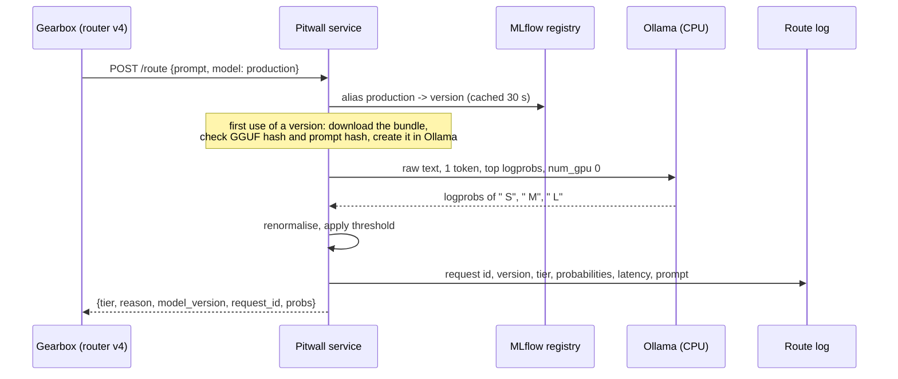
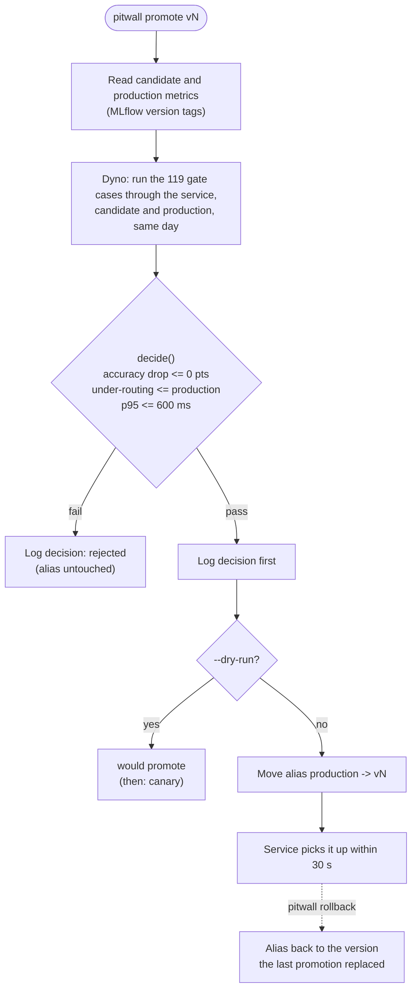
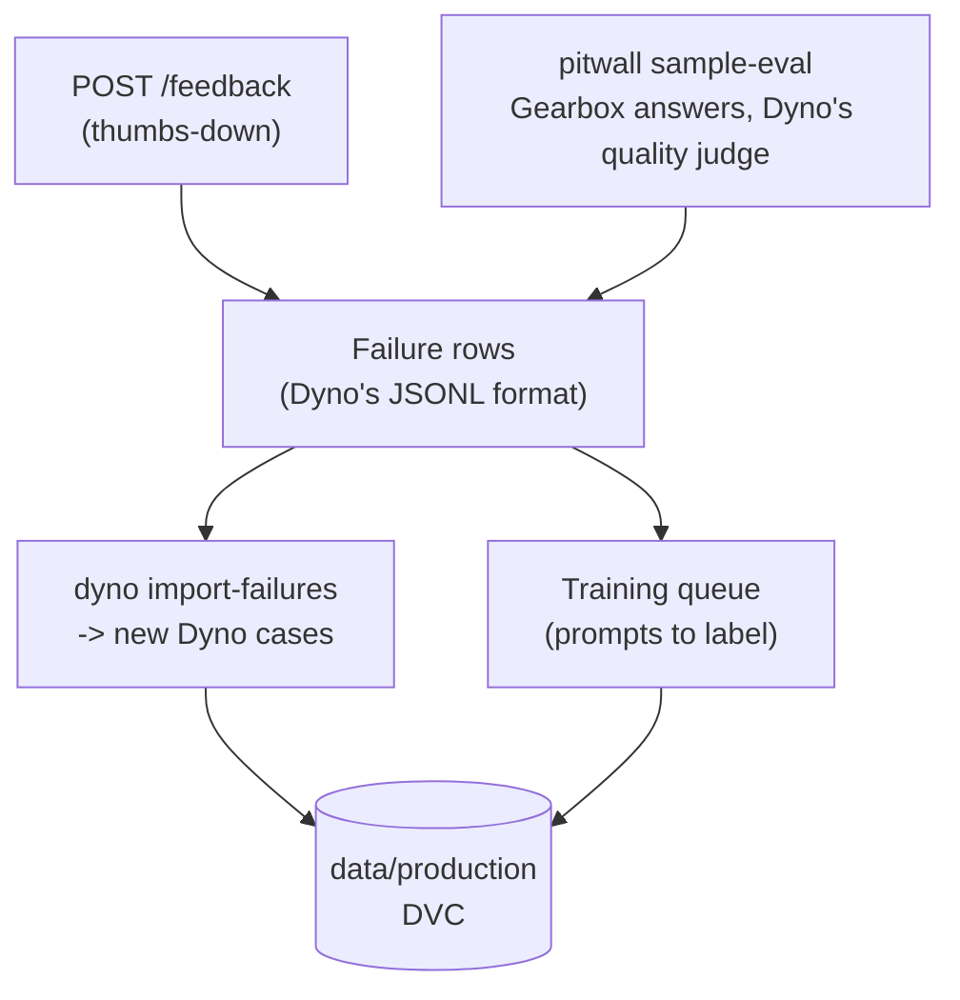

# Pitwall design

How the pieces fit, why they were chosen, and where each fact is recorded. The README
has the results; this page has the mechanics.

## 1. The model and its data

**Task.** Given a prompt, pick the cheapest of Gearbox's tiers that answers it well:
S (a local 3B model), M (Claude Haiku), L (Claude Sonnet). The labels come from Gearbox:
every prompt was answered by all three tiers and judged; the label is the cheapest tier
that scored at least 4/5.

**Data.** Gearbox's labelled dataset (600 prompts) is imported with `dvc import-url`
from a pinned Gearbox commit, and `dvc repro` turns it into instruction pairs:

| File | Prompts | What it is |
|---|---|---|
| `test` | 119 | Gearbox's test split, the same for every model, scored once per model |
| `train_old` | 365 | general prompts (MT-Bench, HumanEval, MBPP, GSM8K, MATH, TriviaQA, TruthfulQA, Dolly) |
| `pool_new` | 116 | SimpleQA, AIME 2025, MMLU-Pro: the "new traffic" of the drift simulation |
| `train_full` | 481 | old + new: what a retrained model learns |

CI rebuilds the data from scratch on every push and fails if any hash in `dvc.lock`
changes. The instruction text lives in `prompts/router_v1.yaml`; its hash travels with
every dataset, bundle and MLflow run.

**The text the model reads** (`textformat.py`, version `pitwall-completion/1`):

```
<system instruction>

Request:
<prompt, cut at 3,000 characters>

Tier:
```

The model continues with one token, ` S`, ` M` or ` L`. No chat template: Hugging Face
and Ollama apply templates differently, and a model trained on one text and served
another still answers, just worse. Ollama's raw mode sends this text as is; the token
count matches the training tokenizer's.

**Training** (`finetune/train.py`, on a free Colab T4): LoRA (r 16) on
Qwen3-0.6B-Base at a pinned revision, fp32 weights with fp16 autocast. The loss is
computed at one position only (after `Tier:`): scoring every position for the whole
vocabulary needed ~4 GB and ran the T4 out of memory. Gradient checkpointing and
batches of similar length keep activations small (peak 4.2 GB). 20% of the training
file is held out to choose the number of epochs and the threshold by routing cost
(an under-route counts double), then the model is retrained on everything, merged,
converted to GGUF and quantised to Q4_K_M with a pinned llama.cpp release.

**Bundle.** `model.gguf`, the LoRA `adapter/`, and `bundle.json`: base model and
revision, data version, training file hash, prompt hash, text format, settings, the
validation table, library versions, GGUF sha256. `pitwall bundle check` verifies it.

**Decision rule.** P(S), P(M), P(L) are the model's probabilities for the three
tokens, renormalised. The tier is the cheapest whose cumulative probability reaches
the threshold: S if P(S) >= t, else M if P(S) + P(M) >= t, else L. The same rule as
the logistic regression baseline, so the two are tuned the same way.

## 2. Serving a request



- **Fail-safes.** No S/M/L among the model's top tokens: answer M and flag
  `fallback`. Ollama down, or no model for the alias: 503. Gearbox's router v4 turns
  any of these into M ("pitwall unavailable") and keeps answering.
- **CPU only** (`num_gpu: 0`): the GPU belongs to Gearbox's local tier S.
- **Models over HTTP.** A version is uploaded to Ollama as a blob and created through
  its API, so the service also works from a container.
- **Request ids.** Gearbox's log reason carries Pitwall's request id, so feedback on a
  Gearbox answer finds the routing decision behind it.

## 3. Promotion, canary and rollback



- **The rule is a pure function** (`promote.decide`): no network, no MLflow. Its tests
  (`tests/test_promote.py`) are the contract for anyone changing it.
- **The decision is written before the alias moves**, so a promotion never happens
  without its record (the first real promotion crashed after moving the alias; that
  order is now tested).
- **First promotion.** With no production model, the baseline is the trivial rule
  "always M" (`dyno_agent.AlwaysM`): a model has to at least match it.
- **One attempt per case.** The router answers at temperature 0; two Dyno runs of the
  same version agreed on all 119 cases.
- **Canary.** Gearbox registers router v4 twice: `v4-finetuned` (Pitwall's
  production) and `v4-candidate` (its candidate). Gearbox's own canary setting sends a
  share of traffic to the candidate (`pitwall canary config` writes that configuration
  without touching Gearbox's repository). The canary is evidence from real traffic; at
  10% it sees few requests (3 or 5 of 40), so the decision stays with the gate.
- **Rollback** refuses when there is nothing to go back to (no promotion yet, or the
  first model, which replaced "always M") and when it has already been done.

## 4. Monitoring and drift

**Metrics** (`GET /metrics`): decisions by alias, version, tier and fail-safe; a
latency histogram with buckets around 600 ms; errors by reason; the version each alias
serves; prompt length; feedback; the latest drift check. **Alerts**: service down,
p95 over 600 ms for 10 minutes, fail-safes over 5%, errors, drift. The Prometheus
configuration, alert rules and Grafana dashboard are files in `monitoring/`, checked by
`promtool` and by a test that every query names a metric the service exports.

**Drift** (`pitwall drift check`) compares the last N prompts a model routed (each
counted once) with that model's own training file:

| Feature | How | Drifted when |
|---|---|---|
| Prompt length | Kolmogorov-Smirnov | p < 0.05 |
| Task mix | chi-square on a task type predicted from embeddings (nearest training centroid) | p < 0.05 |
| Meaning | Evidently's domain classifier on bge-small embeddings | ROC AUC > 0.7 |

Drift is declared when at least half the features drift. The result is stored, so
the service exports it, `PitwallDrift` can fire, and Grafana shows it. The command
exits with code 3, so a script can start a retrain.

## 5. Failures back into training



Case ids follow Dyno's own rule (SHA-256 of the normalised prompt), so the same
failure always becomes the same case and repeats are skipped. Both files are
production prompts, so they are versioned with DVC and kept out of git.

## 6. Where everything is recorded

| What | Where |
|---|---|
| Source data, splits, gate cases | DVC (`dvc.lock` in git; Gearbox's files fetched from a pinned commit) |
| Production failures, training queue | DVC (`data/production.dvc` in git, the files local) |
| Every training, evaluation, comparison, promotion, rollback, canary and drift check | MLflow runs in the `router` experiment, tagged with data version, prompt hash and git commit |
| Model versions and which one serves | MLflow registry `pitwall-router`, aliases `production` and `candidate` |
| Each routing decision, feedback, drift results | SQLite (`pitwall.db`, schema by Alembic) |
| Gate runs | Dyno's store (`dyno.db`) |
| Live behaviour | Prometheus; Grafana dashboard |

## 7. Decisions

| Decision | Reason |
|---|---|
| A 0.6B base model | Fits CPU serving next to Gearbox's local model; the 0.8B newer option was a multimodal hybrid with riskier LoRA and GGUF support |
| Evaluate on the quantised model, on CPU | Scores and latency of what actually serves |
| p95 limit 600 ms (first guess was 300) | Measured: ~60 ms short prompts, ~300 ms+ long ones; 300 would reject any LLM router on CPU |
| Probabilities from top logprobs | Ollama reports only the top 20 tokens; a tier missing from them counts as 0, none of the three is a visible fallback |
| Drift windows count each prompt once | Repeats inflated the embedding classifier to AUC 0.81 on normal traffic |
| Child processes read and write UTF-8 | A Windows code page broke the first `retrain finish` |
| Re-registering refreshes a version's metrics | The gate must read the newest measurement |

## 8. Connection points

| Project | How Pitwall connects |
|---|---|
| Gearbox | Imports its labelled data (DVC, pinned commit); its offline replay prices each router's picks (its CLI, its own environment); its router v4 calls `POST /route`; canaries use its traffic split |
| Dyno | The promotion gate (`dyno run` + `from dyno.gate import gate`), the quality judge for sampled answers, `dyno import-failures` for new cases |
| Scout | Through Gearbox: Scout's model calls go through Gearbox, which can route through Pitwall |
